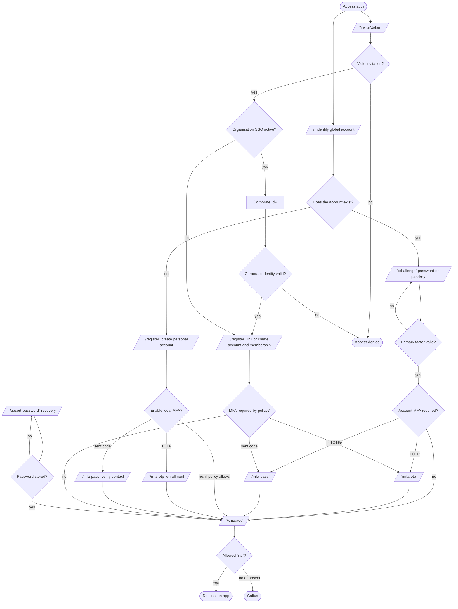
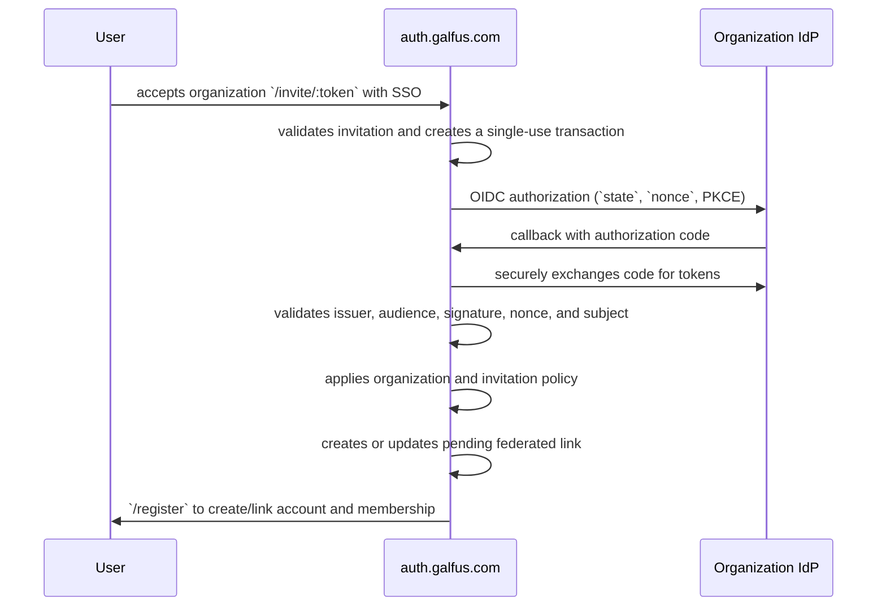

# Authentication flow

> Status: planning. This document describes the target flow; it does not alter
> the current endpoints or schema.

## Conventions

- The final endpoint is `/success`, with two `c` characters. Do not create
  `/sucess`.
- Each journey uses an opaque **authentication transaction**. Its immutable
  `kind` is `authorization`, `registration`, `organization_invitation`,
  `password_recovery`, or `upsert_password`. An invitation grant lasts seven
  days; redeeming it creates a short-lived browser-bound child transaction.
- A stateless access credential authenticates the **global account**. The active organization is
  a context selection, as in GitHub; each app confirms that the account's
  membership in that organization remains active before authorizing a resource.
- A transaction identifier (for example, a ULID) is not a secret.
  Authorization tokens, OTPs, `state`, `nonce`, and `code_verifier` must use
  cryptographic randomness, expire, be single-use, and never appear in logs.
- `rto` remains limited to allowed Galfus origins. The `/success` page never
  receives an access token in the URL; the app issues a stateless access JWT in
  an HttpOnly cookie before rendering or redirecting from that page.

## Target routes

| Route                | Responsibility                                                                                                                                               | Next step                                                                               |
| -------------------- | ------------------------------------------------------------------------------------------------------------------------------------------------------------ | --------------------------------------------------------------------------------------- |
| `/`                  | Normalizes an email or username and looks up the global account.                                                                                             | Existing account: `/challenge`; otherwise: personal `/register`.                        |
| `/invite/:id/:token` | Entry point for a single-use invitation valid for seven days. Validates the opaque link and starts a browser-bound child transaction.                        | Active SSO: corporate IdP; no SSO: regular `/register` with inherited invitation scope. |
| `/register`          | Public for personal accounts. With an invitation, creates or links a global account to the organization; with active SSO, it first requires corporate proof. | Completion: `/success`; chosen enrollment: corresponding MFA step.                      |
| `/challenge`         | Global authentication by password or passkey. An organization may require its own reauthentication/SSO when its resources are accessed.                      | No pending MFA: `/success`; MFA: `/mfa-otp` or `/mfa-pass`.                             |
| `/mfa-otp`           | Verifies TOTP; in enrollment mode, confirms the first code before activating the factor.                                                                     | `/success`.                                                                             |
| `/mfa-pass`          | Verifies a single-use code sent to a previously verified contact (email and/or SMS).                                                                         | `/success`.                                                                             |
| `/success`           | Confirms that an access cookie was issued; offers continuation or automatically redirects to the validated `rto`.                                            | Destination app.                                                                        |
| `/upsert-password`   | Sets or replaces the global account password from an `invite` transaction that permits a local password, or from `recovery`.                                 | MFA when required; otherwise `/success`.                                                |

The invitation link carries a **single-use opaque random token**; the database
stores only its hash. It must not carry the hash stored in the database because
that does not prove possession. After validation, an authorization transaction
is stored server-side/in a secure cookie. The invitation expires after seven
days; its delivery will be handled by the future organization portal.
`/register` may include the MFA questionnaire as an internal step. If enrollment
becomes more complex, the same transaction may open `/mfa-otp` in `enroll` mode;
the mode must be in server-side state, not a free URL parameter.

## Target flowchart



## State and security required before implementation

### Authorization transaction

`auth_transaction` is the persisted workflow entity. The UI receives only an
opaque reference; the server remains the source of truth. A seven-day
`organization_invitation` parent has a token hash but no browser verifier. Its
redeemed child has a browser verifier, lasts at most fifteen minutes, and
inherits organization and SSO scope from its parent.

The current flow JWT in the `state` parameter is signed and expires, but it
still appears in the URL, browser history, and potentially in logs or Referer
headers. For the flows above, an opaque transaction is preferable.

### Recommended format: identifier + verifier

Each transaction has two parts:

```text
auth transaction ID:  public ULID, used only for lookup
browser verifier:     32 random bytes, base64url-encoded
cookie:               <transaction-id>.<browser-verifier>
database:             transaction-id + SHA-256(browser-verifier)
```

The ULID supports indexing, tracing, and expiration; it **does not** authenticate
anyone. The verifier is generated with a CSPRNG and proves possession. The app
stores the pair in an `HttpOnly`, `Secure`, `SameSite=Lax` cookie with path `/`
for at most 10–15 minutes. The database stores only the verifier hash and never
accepts the ID by itself. This identifier-plus-secret pattern allows efficient
lookup without allowing a database dump to reuse active transactions. [OWASP
Session Management Cheat Sheet](https://cheatsheetseries.owasp.org/cheatsheets/Session_Management_Cheat_Sheet.html)

The cookie name must be a constant in `@galfus/constants`, for example
`COOKIES_KEYS.auth_transaction`; `apps/auth` creates, renews, and clears it.
`data-manager` receives a database instance and opaque token, but never handles
cookies or redirects.

### `auth_transaction` fields

| Field                                              | Purpose                                                                                                                                    |
| -------------------------------------------------- | ------------------------------------------------------------------------------------------------------------------------------------------ |
| `id`                                               | Public transaction ULID.                                                                                                                   |
| `kind`                                             | `authorization`, `registration`, `organization_invitation`, `password_recovery`, or `upsert_password`.                                     |
| `status`                                           | Finite state: `pending`, `awaiting_sso`, `awaiting_primary`, `awaiting_mfa`, `authorized`, `completed`, `failed`, `revoked`, or `expired`. |
| `parent`                                           | Optional invitation grant from which a browser-bound child journey was redeemed.                                                           |
| `account`, `organization`                          | Optional references defining immutable journey scope.                                                                                      |
| `return_to`                                        | Destination validated at the start; never accept a new `rto` from a later form.                                                            |
| `browser_verifier_hash`                            | SHA-256 hash of the secret kept in the cookie.                                                                                             |
| `metadata`                                         | Validated, kind-specific state. Invitation data, SSO proof, provider callback state, and selected authentication methods belong here.     |
| `attempts`, `expires_at`, `consumed_at`, `version` | Rate limiting, expiration, single-use status, and optimistic concurrency.                                                                  |

Do not store a password, OTP, access token, IdP access token, or IdP refresh
token in cleartext in the transaction. When it is unavoidable to keep a
short-lived secret, such as the PKCE `code_verifier`, encrypt it and remove it
immediately after use.

`metadata` is flexible only at the database layer. The data-manager maps it to
a TypeScript discriminated union through `kind`, validates the input of every
kind-specific transition with Valibot, and writes only parsed fields. It is not
an unvalidated payload bucket. Relationship fields and browser-verifier hashes
stay top-level so they remain queryable and enforceable independently of a
workflow's metadata.

### Atomic operations

`data-manager` must expose small operations, always accepting `unknown`,
validating with Valibot, and performing the transition in a single
query/transaction:

1. `startAuthTransaction`: creates the record and returns the ID + verifier
   only to the app; the app stores the cookie.
2. `getAuthTransaction`: validates format, verifier hash, expiry, and status;
   it never returns internal secrets to the UI.
3. `confirmPasswordAuthTransaction` verifies the account password and moves
   only from `pending` to `awaiting_mfa` or `authorized`. It increments a
   bounded attempt counter on failure.
4. `confirmOtpAuthTransaction` consumes only a matching, transaction-bound MFA
   challenge and moves `awaiting_mfa` to `authorized`. It also records bounded
   failed OTP attempts.
5. `completeAuthTransaction` accepts only `authorized`, marks the transaction
   consumed, and lets the app issue a stateless access JWT in an HttpOnly cookie.
6. `purgeExpiredAuthTransactions`: deletes expired OTP challenges and
   authorization transactions in bounded batches; no endpoint may accept them
   even before cleanup.

`completed`, `failed`, and `expired` are terminal. The app clears the cookie
for every terminal state and on logout.

### OIDC callback and invitation

When SSO starts, the validated transaction generates fresh `state`, `nonce`,
and PKCE values, all specific to that transaction. `state` may carry a
`transaction-id` and its own random secret; the server stores only its hash. In
the callback, Galfus requires all of the following: a valid, unconsumed `state`;
the cookie for the same transaction; the expected issuer/connection; the ID
Token `nonce`; and PKCE `S256`. Only then does it exchange the code and advance
to `authorized`. This prevents injected callbacks, mix-up, and replay.
OIDC/PKCE requires these values to be specific to, and bound to, the browser
that initiated the journey. [RFC 9700](https://www.rfc-editor.org/rfc/rfc9700.html)

The invitation follows the same principle: the random token exposed in the link
is hashed in the database, expires after seven days, and is only marked consumed
when membership is completed. If the browser returns during SSO, the pending
transaction allows it to continue; a second transaction cannot use the same
invitation simultaneously.

### MFA activation and methods

`account_authenticator` represents each persistent authentication method and
its enrollment state. MFA is derived from active authenticators rather than a
duplicated account-level flag. The model follows these rules:

- MFA is **global to the Galfus account**, independent of the IdP and
  organization. Authentication or MFA performed in the IdP does not satisfy or
  replace a Galfus factor: the same account may belong to different
  organizations.
- MFA methods per account (`totp`, `email_otp`, `sms_otp`, recovery codes).
- `pending`, `active`, and `disabled` states plus verification dates.
- A previously verified email/phone contact for sent codes.
- TOTP secrets encrypted at rest, never stored in cleartext.
- A single-use code hash, short expiration, attempt limit, and atomic
  consumption.
- Recovery codes stored only as hashes.

Passkeys are `account_authenticator` records with a credential identifier,
public key, counter, and validated WebAuthn metadata. This allows passkey
authentication in `/challenge` without a separate passkey table.

Email and SMS delivery is a later phase. To avoid coupling the schema to a
delivery provider, use `account_identity`: its provider and normalized
identifier select the delivery channel. A single-use challenge retains purpose,
code hash, expiration, attempts, and consumption. No email/SMS adapter is
required in this phase.

### Pending registration and organization link

A personal account may be created without an organization and become `active`
after meeting global requirements. The `belongs_to` relation created by an
invitation or affected by newly enabled SSO may remain `pending_sso` until the
organization’s required corporate proof is complete. That state belongs to the membership, not the
global account: the person may continue using their personal account or other
organizations while they lack access to that specific organization. When an
organization has enabled SSO, corporate proof is required to activate that
link; it neither replaces the global access credential nor takes control of the personal
account.

### Password upsert

`/upsert-password` must not accept a free-form identity. The transaction kind
defines one of these purposes:

- `organization_invitation`: creates the first password when the invitation/organization permits
  a local password.
- `recovery`: changes a password after proof of possession through the recovery
  channel.

Both must invalidate the transaction and relevant access credentials/recovery codes after
use. Changing the password of an authenticated account requires recent
reauthentication or MFA according to policy.

## Corporate federation: Galfus as a client

Galfus does **not** issue SSO for other systems. Each organization can connect
its own corporate IdP; once connected, Galfus acts as the Relying Party/client
of that connection. The model is vendor-neutral: Microsoft Entra ID, Okta,
Google Workspace, Keycloak, Auth0, and any compatible IdP use the same
abstraction.

The recommended integration is **OpenID Connect Authorization Code Flow with
PKCE**. SAML 2.0 remains an adapter for organizations that only offer SAML.

## Personal external providers

Personal external login is independent from organization SSO. Google, GitHub,
and Steam authenticate the global Galfus account; an organization’s OIDC/SAML
connection only validates access to that organization.

- Google uses OAuth 2.0 Authorization Code with OIDC, nonce validation, and
  PKCE.
- GitHub uses OAuth 2.0 Authorization Code and obtains the stable account ID
  from the authenticated user API response.
- Steam uses OpenID 2.0 and validates the signed assertion with Steam before
  accepting its SteamID64 subject.

Every provider callback is bound to an opaque browser transaction through a
fresh state value. OIDC callbacks additionally use a nonce and PKCE verifier.
The database stores hashes or ciphertext only; access tokens, refresh tokens,
and raw authorization codes are discarded after identity verification.

An external subject is never linked to an existing Galfus account merely
because an asserted email matches. A new subject either signs into its linked
account, opens a registration transaction, or is explicitly linked by an
already authenticated account through a server-authorized operation. A link
transaction is bound to that account and rejects a subject already linked to a
different account.



OIDC is preferred because plain OAuth authorizes resource access but does not
standardize an identity assertion; OIDC adds authentication and the ID Token.
The authorization-code flow, ID Token validation, and PKCE are required parts
of the integration. [OpenID Connect Core](https://openid.net/specs/openid-connect-core-1_0.html), [RFC 7636 (PKCE)](https://www.rfc-editor.org/rfc/rfc7636.html)

### Invitation controls membership; personal account is independent

**Personal account** self-registration exists without an organization. An
administrator only needs to create an invitation to grant membership in an
organization. When the organization has active SSO, the invitation is associated
with its SSO connection and the person receives the `belongs_to` relation only
after they:

1. present a valid, expiring, single-use invitation;
2. successfully authenticate against the invitation-defined SSO connection when
   the organization has active SSO;
3. meet invitation policy, such as an allowed domain/claim, group, or role;
4. complete local MFA when organization policy requires it.

When the organization does not have active SSO, the same invitation skips
external authentication and permits regular registration or linking of an
already authenticated Galfus account. A personal account can create its own
organization later; that organization starts without SSO until an administrator
connects an IdP.

The invitation may be tied to an email as a destination hint, but the
authoritative identity is the `subject` returned by the IdP. If the email claim
differs from the invited email, the organization explicitly decides whether to
deny or allow the case; never implicitly link accounts based on matching email.

### Existence and revocation rule

The product rule is: **a person may access an SSO-enabled organization only
while their external identity is active and authorized by that connection**.
This does not disable their global account or memberships in other
organizations.

### Enabling SSO for an existing organization

Enabling enforcement does not invalidate the global account session. It marks
every currently active `belongs_to` relation in that organization as
`pending_sso`, stores the selected `sso_connection`, and records
`sso_required_at`. Services must deny organization resources while a membership
is `pending_sso`, even when the global account cookie remains valid.

On the next organization access, the application starts an organization-scoped
authorization transaction and redirects to the configured IdP. After the
verified assertion returns, the membership stores the connection's stable
subject, minimal assertion metadata, and verification timestamps before moving
back to `active`. The pair `(sso_connection, federated_subject)` is unique, so
one corporate identity cannot activate another account's membership.

Webhook deprovisioning resolves that same pair directly on `belongs_to` and
sets only that membership to `revoked`. Disabling SSO must be an explicit
organization policy operation; it must never reactivate memberships already
`revoked` or `disabled`.

A new OIDC/SAML authentication already fails when the IdP rejects a disabled
person. Existing stateless access tokens expire according to their TTL, so
immediate blocking requires each service to check current account or membership
state. For each `organization_sso_connection`, record capabilities such as:

- SCIM or event-webhook deprovisioning.
- OIDC Back-Channel Logout, introspection, or another token-status lookup.
- Claims/groups that may be verified on login.
- Reconciliation interval when no revocation event is available.

The baseline behavior is to deny new logins when the IdP denies authentication.
To react quickly to deprovisioning, consume the available channel, perform
periodic reconciliation, and validate account or membership state on protected
requests. On revocation, preserve the account for audit, mark the membership
`revoked`/`disabled`, and deny that organization’s grants. `account.status` is
reserved for global account blocks.

### Proposed data model

In addition to the existing `organization` and `belongs_to` relation, model:

- `organization_sso_connection`: organization, protocol (`oidc` or `saml`),
  issuer/metadata, claim policy, and status. Client secrets belong in a
  vault/environment variables, not in the public database record.
- `auth_transaction`: the sole invitation and authentication workflow entity.
  Invitation grants are parent transactions; browser journeys are their
  short-lived children. Access tokens are stateless JWTs in HttpOnly cookies
  and do not need a database record.
- An organization membership relation, evolving `belongs_to` with status,
  invitation origin, used connection, and revocation date.

Do not use email, UPN, or display name as a linking key: these attributes can
change. The connection and the IdP’s stable `subject` are the key.

After SSO, the transaction verifies global Galfus-account MFA when it is active
or required by applicable policy. The IdP’s assurance does not replace a Galfus
factor because the account may participate in other organizations. This is an
authorization rule, not an interface toggle.

## Open decisions required to close the design

### Blocking schema and initial implementation

1. **Access credential and active organization — decided:** a stateless access
   credential represents only the global account. The user selects the active
   organization; each app checks that organization’s membership per request or
   through a revocable grant.
2. **Organization SSO policy — decided:** SSO is required to activate a
   membership created by invitation when the organization has it active. A
   revocation received by webhook disables only that membership.
3. **Invitations — partially decided:** a single-use opaque-token link, hashed
   in the database and valid for seven days. The organization portal will send
   it later. Initial role, resend, email transfer, and reauthentication of an
   existing account remain open.
4. **SSO provisioning — decided:** every organization membership originates
   from an invitation, whether it has SSO or not. With active SSO, the
   invitation adds corporate proof before activating membership; without SSO,
   it creates the regular link.
5. **MFA — partially decided:** factors are global to the Galfus account and
   are never replaced by IdP MFA because an account may belong to multiple
   organizations. Email/SMS delivery is deferred; the schema must support
   verified contacts and challenges without integrating a provider yet. First
   version factors, recovery, and whether an organization can require existing
   Galfus MFA remain open.
6. **External revocation — decided:** it occurs through a corporate-system
   webhook. The event contract, signature, idempotency, and processing SLA are
   still required; it revokes that organization’s membership and grants.
7. **Local credentials — partially decided:** password and passkey belong to
   the global account, not membership. Corporate SSO is required to activate an
   invitation link, not on every later access. Email verification for password
   creation and recovery remains open; email/SMS delivery is outside phase one.

### Security and operations

8. **Times and limits:** invitation, transaction, OTP, and WebAuthn-challenge
   TTLs; access-token lifetime; attempt count; rate limit by
   IP/identity; and a uniform response to avoid account or invitation
   enumeration.
9. **Secrets and keys:** locations for SSO client secrets, transaction
   encryption keys, and TOTP secrets; rotation, development environment, and
   operator access. Never store an IdP refresh token without a concrete need.
10. **Audit:** which events are immutable and for how long: invitation creation
    and acceptance, SSO login/error, factor change, recovery, identity linking
    and unlinking, membership revocation, and access-token issuance.
11. **Organization ownership:** rules for the first owner, administrator
    invitations, removal/transfer of the last owner, and behavior when an SSO
    connection is disabled or changed.

### May be deferred to later phases

12. SAML, complete SCIM, multiple active connections per organization,
    automatic IdP-group-to-Galfus-role mapping, and domain login discovery.
13. Passkeys, recovery codes, email/SMS authentication, and step-up for a
    sensitive action may be added gradually after access credentials,
    invitations, and OIDC
    are complete.

### Minimum decision order

To begin implementation safely, the decisions already made allow creating the
`organization_sso_connection` and `auth_transaction` tables, and evolving
`belongs_to`. Items **8–11** belong in
the first technical delivery; items **12–13** do not need to block OIDC plus
invitations.
