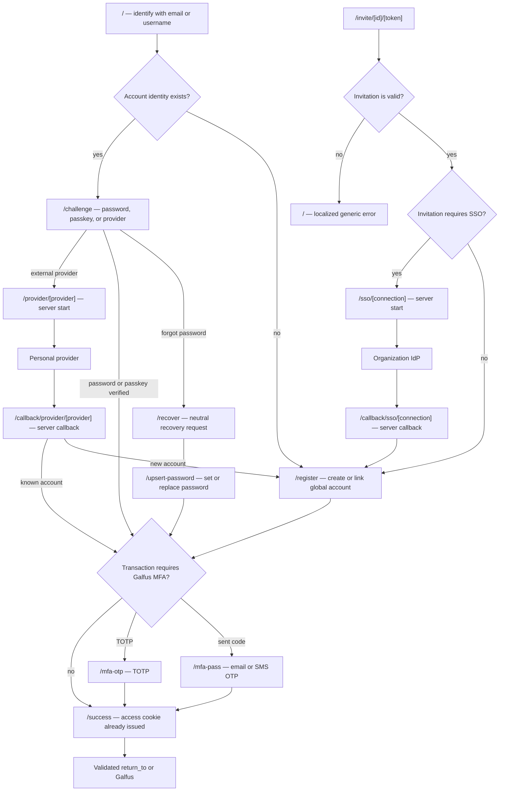

# Authentication route relationships

> Status: target route architecture. This document defines navigation and
> ownership boundaries for `apps/auth`; it does not claim that every route is
> implemented yet. See [the authentication flow](./authentication-flow.md) for
> transaction, federation, and security rules, and [the database entity
> relationships](./database-entity-relationships.md) for persisted state.

## Route principles

- A page URL identifies an interaction, never an authentication transaction.
  The current browser journey is identified by the `auth_transaction` HttpOnly
  cookie (`<transaction-id>.<browser-verifier>`). The server validates it
  before every transition.
- `rto` is accepted only when a journey begins, validated against Galfus
  origins, and stored as `auth_transaction.return_to`. It is not propagated
  through later URLs or forms.
- `/success` is spelled with two `c` characters. It is the only confirmation
  page; it never receives an access credential in its URL.
- A route can render only the state that the server has loaded from the current
  transaction. A form must not choose its own transaction status, account,
  organization, MFA method, SSO connection, or return destination.
- URLs use lowercase kebab-case. Persisted data remains snake_case; route
  naming does not affect database naming.
- Provider and SSO callbacks are server endpoints, not interactive Svelte
  pages. They validate the callback, advance the transaction, and redirect to
  an appropriate page.

## Proposed route tree

```text
/
/register
/challenge
/mfa-otp
/mfa-pass
/recover
/upsert-password
/success
/invite/[id]/[token]
/provider/[provider]             # server action/endpoint to begin personal provider sign-in
/callback/provider/[provider]    # server callback endpoint
/sso/[connection]                # server action/endpoint to begin organization SSO
/callback/sso/[connection]       # server callback endpoint
```

`[id]` is the public ULID of an invitation transaction and `[token]` is its
high-entropy, single-use secret. The database stores only the secret hash.
Neither segment is an access credential. All other authentication state lives
in the secure transaction cookie after the invitation is redeemed.

`[provider]` is an allowlisted personal provider (`google`, `github`, or
`steam`). `[connection]` is an allowlisted organization SSO connection. Both
must be resolved server-side; they must never be accepted as arbitrary issuer
or redirect URLs.

## Page responsibilities and admissible state

| Route                  | User-facing responsibility                                                                                              | Required transaction state                                                          | Permitted next route or result                                                                                               |
| ---------------------- | ----------------------------------------------------------------------------------------------------------------------- | ----------------------------------------------------------------------------------- | ---------------------------------------------------------------------------------------------------------------------------- |
| `/`                    | Collect and normalize an email or username.                                                                             | None before submit.                                                                 | Creates a browser-bound journey. An existing account goes to `/challenge`; a new identity goes to `/register`.               |
| `/register`            | Create a personal account, or create/link one while redeeming an invitation or an unknown personal provider identity.   | `registration/awaiting_primary`, or a verified journey in `awaiting_registration`.  | Optional MFA enrollment, then `/success`. An invitation completion also creates `belongs_to`.                                |
| `/challenge`           | Prove the global account with password, passkey, or a personal external provider.                                       | `authorization/awaiting_primary`; an account is already bound for password/passkey. | `/mfa-otp`, `/mfa-pass`, `/success`, provider start endpoint, or `/upsert-password` for recovery.                            |
| `/mfa-otp`             | Verify an active TOTP authenticator; it also hosts TOTP enrollment when the transaction explicitly requests enrollment. | `awaiting_mfa` or an explicit MFA-enrollment state.                                 | `/success`.                                                                                                                  |
| `/mfa-pass`            | Verify a transaction-bound email or SMS one-time passcode. Delivery is delegated to the future messaging adapter.       | `awaiting_mfa` with `email_otp` or `sms_otp` selected by the server.                | `/success`.                                                                                                                  |
| `/recover`             | Start password recovery without revealing whether an account exists.                                                    | None before submit.                                                                 | Always gives a neutral delivery response. A verified recovery delivery opens `/upsert-password`.                             |
| `/upsert-password`     | Create or replace a password only after the transaction's invitation or recovery proof.                                 | `upsert_password` or `password_recovery` with its required proof completed.         | MFA when policy requires it; otherwise `/success`.                                                                           |
| `/success`             | Confirm completion and continue to the stored validated destination.                                                    | A just-completed transaction or a short-lived server-side completion indicator.     | Redirects to `return_to` or the Galfus default destination.                                                                  |
| `/invite/[id]/[token]` | Redeem a seven-day organization invitation link.                                                                        | The invitation grant must still be `organization_invitation/pending`.               | SSO start endpoint when required; otherwise `/register`. Invalid or expired links end at `/` with a generic localized error. |

The MFA routes are intentionally split by proof type. The server chooses the
route from the transaction and active authenticator; `?method=...` is not a
valid control surface. A future method-picker, if needed, belongs at a route
such as `/mfa`, but it must only select among server-authorized methods and
then update the transaction atomically.

## Server-only endpoints

| Endpoint                        | Responsibility                                                                                                                                                       | Redirect after successful processing                                                                       |
| ------------------------------- | -------------------------------------------------------------------------------------------------------------------------------------------------------------------- | ---------------------------------------------------------------------------------------------------------- |
| `/provider/[provider]`          | Starts a personal Google, GitHub, or Steam journey. It creates or advances an `authorization` transaction, stores the browser cookie, and redirects to the provider. | External provider.                                                                                         |
| `/callback/provider/[provider]` | Validates OAuth/OIDC/OpenID callback data and transaction binding. It discards provider tokens after extracting the stable subject.                                  | Known identity: MFA or `/success`; unknown identity: `/register`; link mode: account settings return path. |
| `/sso/[connection]`             | Starts the configured organization OIDC or SAML flow for an invitation or a membership requiring fresh corporate proof.                                              | Organization IdP.                                                                                          |
| `/callback/sso/[connection]`    | Validates the organization IdP callback and the invitation/membership policy.                                                                                        | `/register` if a Galfus account must be created or linked; otherwise MFA or `/success`.                    |

These endpoint routes should allow only their respective provider/connection
and expected transaction state. They do not render provider data, expose
authorization codes, or accept a caller-supplied `return_to` value.

## URL transition diagram



## Transaction-to-route state map

The server is the single dispatcher. After every mutation it loads the
transaction and applies this mapping; a page should redirect away when the
current state is not admissible for that page.

| Transaction kind                         | Status                                         | Route or server action                                                                                     |
| ---------------------------------------- | ---------------------------------------------- | ---------------------------------------------------------------------------------------------------------- |
| `authorization`                          | `pending` or `awaiting_primary`                | `/challenge`                                                                                               |
| `authorization`                          | `awaiting_provider`                            | Wait for `/callback/provider/[provider]`; do not render an interactive page.                               |
| `authorization`                          | `awaiting_sso`                                 | Start `/sso/[connection]` or wait for its callback.                                                        |
| `authorization`                          | `awaiting_registration`                        | `/register`                                                                                                |
| `registration`                           | `awaiting_primary`                             | `/register`                                                                                                |
| `password_recovery` or `upsert_password` | `awaiting_primary`                             | `/upsert-password` after recovery proof is complete.                                                       |
| Any browser journey                      | `awaiting_mfa`                                 | `/mfa-otp` or `/mfa-pass`, selected from persisted server state.                                           |
| Any browser journey                      | `authorized`                                   | Server completes it, issues the access cookie, then redirects to `/success`.                               |
| Any browser journey                      | `completed`, `failed`, `revoked`, or `expired` | Clear the transaction cookie and redirect to `/` with a generic localized outcome.                         |
| `organization_invitation`                | `pending`                                      | Only `/invite/[id]/[token]` may redeem it. It is not a browser journey and has no browser-verifier cookie. |

An external-provider callback for an unknown identity transitions its
`authorization` journey to `awaiting_registration`. An organization SSO
callback records corporate proof for the invitation or membership before
account creation/linking. It must not automatically attach an external
provider identity to an account based only on a matching email address.

## Cookie and redirect lifecycle

```mermaid
sequenceDiagram
  participant B as Browser
  participant A as apps/auth
  participant D as data-manager / SurrealDB
  participant P as Provider or IdP

  B->>A: POST / or open invitation link
  A->>D: create or redeem opaque transaction
  A-->>B: Set auth_transaction HttpOnly cookie + 303 page/IdP
  B->>A: GET interactive page or callback
  A->>D: validate id + verifier hash + status + expiry
  alt provider/SSO callback
    A->>P: validate code/assertion
    A->>D: atomically advance transaction
    A-->>B: 303 next interactive page
  else final proof
    A->>D: atomically complete authorized transaction
    A-->>B: Set auth_access_token; clear auth_transaction; 303 /success
  end
  B->>A: GET /success
  A-->>B: 303 validated return_to or render completion
```

`auth_transaction` is short-lived, `HttpOnly`, `Secure` outside local
development, `SameSite=Lax`, and cleared at every terminal state. The global
`auth_access_token` is a stateless, HttpOnly access credential. It authorizes
the account, not an organization: target services still check the selected
organization's `belongs_to` state on each protected operation.

### Cookie scope

Production cookies that must be available to Galfus applications use
`Domain=.galfus.com` and `Path=/`. Cookie domains do not accept wildcard
syntax: `*.galfus.com` is invalid, whereas `.galfus.com` covers
`galfus.com` and its subdomains. Local development uses host-only cookies on
`localhost`; cookies are port-independent, so the local auth and application
ports can share them without a `Domain` attribute.

`auth_access_token` is a signed JWT and uses that shared production scope.
The short-lived `auth_transaction` cookie is an opaque bearer verifier whose
hash is validated against the database. It remains host-only on
`auth.galfus.com` by default because no other application needs it; this avoids
giving every subdomain the ability to overwrite a browser-journey cookie. If a
future flow truly needs it on another Galfus subdomain, it must use
`Domain=.galfus.com` deliberately and retain the database verifier check.

## Required implementation alignment

The current `apps/auth` routes still carry a signed `state` JWT in query
parameters and use the legacy `/mfa` page. The target above replaces that
transport with the already available opaque transaction cookie helpers and
splits it into `/mfa-otp` and `/mfa-pass`.

Before implementing the target UI, the following boundary cases need explicit
server actions and tests:

1. Start a personal registration transaction from `/` and dispatch it to
   `/register` without a URL state token.
2. Start recovery from `/recover` and bind delivery verification to a
   `password_recovery` transaction. The future messaging adapter may send the
   link or code, but must not decide account existence or authorization.
3. After an organization SSO callback, preserve the verified corporate proof
   while `/register` creates or links the global account, then atomically
   consume the invitation and create `belongs_to`.
4. Model MFA enrollment as an explicit transaction transition before routing
   to either MFA page. Do not infer enrollment from an untrusted form field.
5. Add route guards that clear stale cookies and give the same generic outcome
   for missing, expired, revoked, or mismatched browser transactions.
6. Test direct navigation, browser back/refresh, duplicate form submission,
   callback replay, and a second redemption of the same invitation.

This document deliberately leaves account settings routes out of scope. An
authenticated external-provider link belongs there, but it uses the same
`/provider/[provider]` and `/callback/provider/[provider]` endpoint pair with
an account-bound `link` transaction.
