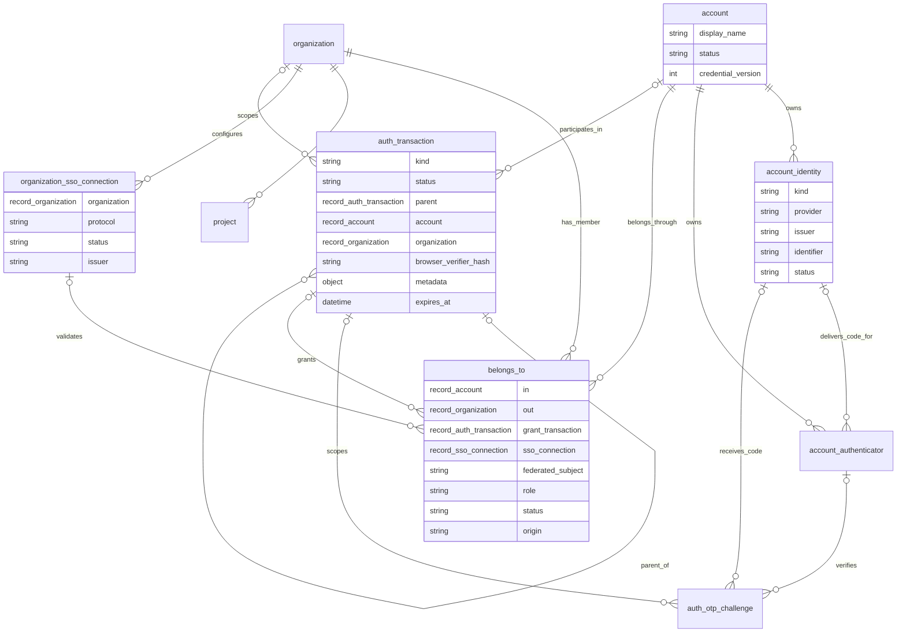

# Database entity relationships

This diagram is a reference view of the shared SurrealDB schema. The source of
truth is `packages/data-manager/database/modules/*/schema/*.surql`.

## Responsibilities

- `account` is the global person/account boundary. Organization membership,
  corporate federation, and revocation never delete the global account. Its
  `credential_version` invalidates older stateless access credentials after a
  security-sensitive change.
- `belongs_to` is the unique relation from an account to an organization. Its
  optional `grant_transaction` records the invitation transaction that granted
  the membership. When SSO applies, it also retains the connection, stable IdP
  subject, minimal assertion metadata, and SSO verification timestamps.
- `auth_transaction` is the sole expiring workflow primitive. A
  `organization_invitation` row is a seven-day grant identified by an opaque
  link secret. Redeeming it creates a short-lived browser-bound child row whose
  `parent` points at the grant. Other kinds support personal authorization,
  registration, recovery, and password updates.
- `organization_sso_connection` describes an organization's external IdP. The
  IdP subject is intentionally membership-scoped: the same connection and
  subject can authorize only one organization membership.
- `account_identity` represents both local (`email`, `username`) and external
  (`google`, `github`, `steam`) identities. `identifier` is the normalized
  local value or immutable provider subject; `(provider, issuer, identifier)`
  is unique. It is distinct from membership-scoped corporate SSO subjects.
- `account_authenticator` and `auth_otp_challenge` model reusable
  authentication methods and single-use proof challenges respectively.

The invitation transaction retains its role, optional target email, issuer,
optional SSO connection, and token hash inside its kind-specific metadata;
the organization, status, and expiry remain stable top-level fields.
Membership completion conditionally consumes that parent transaction and
completes its browser journey in the same database transaction. This prevents
two simultaneous redemptions from creating two memberships or reusing a link.
